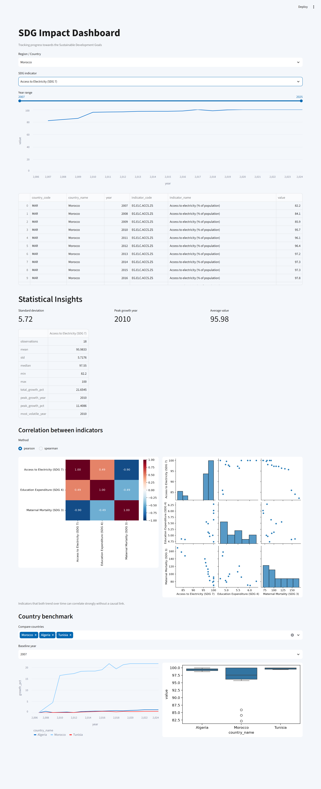

# SDG Impact Dashboard

A Streamlit app for fetching, cleaning and visualising World Bank Sustainable Development Goal (SDG) indicator data.



## Features

- ETL pipeline built on `wbgapi` that pulls the last 20 years of four SDG indicators for every country.
- Local SQLite cache so the dashboard filters instantly instead of hitting the API on every widget change.
- Pure pandas statistics: annualised growth, rolling volatility, Pearson/Spearman correlation between indicators, and growth normalised to a baseline year.
- Streamlit UI with country, indicator and year-range filters, plus a multi-country benchmark view.

Indicators currently tracked:

| Code | SDG | What it measures |
| --- | --- | --- |
| `SI.POV.DDAY` | 1 | Poverty headcount ratio at $2.15/day |
| `SH.STA.MMRT` | 3 | Maternal mortality ratio |
| `SE.XPD.TOTL.GD.ZS` | 4 | Government expenditure on education (% of GDP) |
| `EG.ELC.ACCS.ZS` | 7 | Access to electricity (% of population) |

## Quickstart

```bash
# 1. Set up environment
python -m venv .venv
source .venv/bin/activate  # On Windows: .venv\Scripts\activate
pip install -r requirements.txt

# 2. Run ETL script to populate database (needs internet access)
python -m src.etl

# 3. Launch dashboard
streamlit run app.py
```

Run the tests with:

```bash
python -m unittest discover -s tests -t .
```

## Project Structure

```
├── src/
│   ├── etl.py          # Data extraction & cleaning pipeline
│   ├── db_manager.py   # SQLite interface
│   └── analytics.py    # Pandas statistical calculations
├── app.py              # Streamlit frontend entrypoint
├── tests/              # Unit tests for the analytics layer
├── data/               # sdg_data.db lands here (git-ignored)
├── .streamlit/         # Theme config
└── requirements.txt
```

## Key Design Decisions

- **SQLite caching:** The World Bank API is slow enough that querying it on every filter change makes the UI unusable. The ETL writes one tidy `sdg_indicators` table with indexes on `(country_name, indicator_code, year)`, and the app only ever reads from that.
- **Drop regional aggregates:** `wb.data.fetch(..., skipAggs=True)` excludes entries like "Sub-Saharan Africa" or "World" so the country selector only contains actual countries.
- **Annualised growth across gaps:** Many series have missing years (poverty data especially). Growth between consecutive observations is annualised by the number of years between them, so a 2015 → 2020 step isn't treated like a single-year jump.
- **Correlation needs overlap:** Indicators are joined on year and correlated only where both report. Fewer than 3 overlapping years returns `NaN` and the UI says so instead of showing a meaningless number.
- **Benchmark on normalised growth:** Comparing Morocco's electricity access to Algeria's in absolute terms is uninformative when both sit near 100%. The benchmark rescales each country to its own baseline-year value so you compare pace, not level.
- **Replace, don't append:** Each ETL run drops and recreates the table. Simpler than upserts, and the database always reflects one consistent extract.
- **Defensive parsing of API output:** `wbgapi` returns time values as `YR2020` strings or `{'id': ..., 'value': ...}` dicts depending on the `labels` flag, so the transform step normalises both before loading.

## Notes

- `sqlite3` ships with Python, so it's not in `requirements.txt`.
- Some country/year combinations are genuinely missing from the source and stay missing after cleaning; the app handles empty results rather than interpolating.
